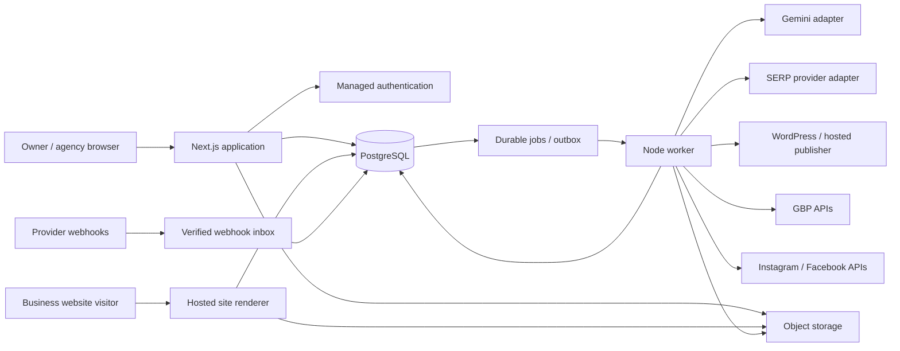

# Architecture and engineering specification

Everything below is a proposed architecture for LocalPilot, not a claim about Outrank's implementation.

## 1. System structure

Use a modular monolith with independently running web and worker processes. One repository, one migration history, one shared contract library. Split services only when measured workloads or team ownership justify it.



### Selected stack

| Layer | Initial choice | Reason / constraint |
|---|---|---|
| Language | TypeScript throughout | Shared types and fewer AI-generated integration mismatches |
| Web | Current stable supported Next.js + React | SSR marketing, dashboard and hosted pages in one codebase |
| UI | Tailwind, accessible Radix/shadcn-style primitives, Lucide | Fast composition; theme through centralized tokens |
| Client state | TanStack Query for remote jobs/data; local state for forms | Avoid a global store for every API response |
| Forms/contracts | React Hook Form + Zod | Shared validation; explicit server-side authorization |
| Data/auth | Supabase PostgreSQL/Auth initially | Managed identity, relational data and backup options |
| ORM | Drizzle; SQL migrations for constraints/RLS | Transparent SQL and low worker overhead |
| Queue | pg-boss or an equivalently proven PostgreSQL job library | No Redis bill at launch; separate job schema and least-privilege role |
| Editor | TipTap with restricted extensions | Structured content, revisions, safe renderers |
| Storage | S3-compatible R2 | Media, generated assets, audit artifacts with source-specific retention |
| Analytics UI | Recharts or equivalent; tables before exotic charts | Owner-friendly charts; accessible tabular alternatives |
| Maps | Grid-only visualization first; MapLibre with licensed tile source later | Ranking API and basemap licensing are separate costs |
| Hosting | Containerized web/worker on a small VM | Long-running work and scheduling fit conventional workers |
| Tests | Vitest, integration DB tests, Playwright E2E | Focus on real failure and permission boundaries |

At Phase 0, pin exact compatible versions and commit lockfiles. Verify queue-library PostgreSQL requirements and privileges against the managed database; do not discover this after building jobs around an unsupported configuration. Use a supported direct/session connection for long-running workers, not a transaction pooler that breaks library assumptions.

Cheapest cash variant: PostgreSQL and authentication hosting can be self-managed, but do not write a custom identity system. Use a maintained auth library with secure session defaults. The recommended route spends more on managed identity/database to reduce launch risk and maintenance.

### Repository layout

```text
apps/
  web/                   # marketing, dashboard, HTTP APIs, hosted renderer
  worker/                # scheduled and queued jobs
packages/
  domain/                # business rules, authorization, state transitions
  db/                    # schema, migrations, query helpers, RLS
  contracts/             # request/response schemas and event payload versions
  integrations/          # google, meta, wordpress, dataforseo adapters
  ai/                    # prompts, providers, generation and evaluation
  ui/                    # tokens, components, typography
  site-templates/        # versioned business-site blocks and renderers
  observability/         # logger, correlation IDs, metrics
  config/                # typed environment and feature flags
docs/
  plan/ adr/ runbooks/ integration-contracts/
tests/
  fixtures/ integration/ e2e/ evaluations/
scripts/
  imagegen.mjs seed-demo.ts reconcile-jobs.ts
infra/
  compose.yaml proxy/ backup/ deploy/
```

If this layout slows initial work, keep the same module boundaries inside one app and extract packages later. Never import UI code into workers or provider SDKs into domain rules.

## 2. Tenant model and authorization

Organization owns membership and billing. Business owns shared branding and facts. Location owns local facts, profiles, keyword tracking, campaigns and quotas. A single-location business still gets a location record. Every tenant-owned object has `organization_id`; location-bound data also has `location_id`.

Roles: owner (billing, deletion, all permissions), admin (business/integrations/policies), editor (draft and submit), approver (approve scoped content), analyst (read/report), billing manager (financial access), platform operator (separate internal capability).

Permission checks are capabilities plus resource scope, not just role strings. Example: `content:approve` for location A does not grant approval at B. Membership is checked server-side against the authenticated user. Ignore any organization ID supplied as proof of access by the browser.

Use RLS for client-accessible data and tenant-safe server repositories. Use composite foreign keys or equivalent validated constraints to prevent linking a campaign from one organization to another organization's location. Public site read access is limited to published projections, never draft tables.

Workers use an internal role but require explicit organization/location context for each job. Do not run arbitrary user-selected SQL through privileged connections. Cache keys, job keys, object paths and logs include tenant scope. Automated cross-tenant negative tests cover reads, writes, exports, signed URLs and background jobs.

## 3. Data schema blueprint

Use UUID identifiers, `timestamptz`, UTC instants, immutable creation time, and updated/version fields. Money uses integer minor units plus currency; provider usage uses decimal quantities and price snapshots. Avoid floating-point financial calculations.

| Tables | Essential fields and behavior |
|---|---|
| organizations, memberships | Name, plan, user role, membership scope and status |
| businesses, locations | Country, timezone, category, address visibility, owner-confirmed identity |
| business_facts, fact_sources, fact_revisions | Typed value, location override, source, confidence, confirmation, validity period |
| brand_profiles, brand_assets | Voice, colors, approved logo/photo references, usage rights |
| integrations, integration_assets | Provider, auth route, account/page/location IDs, selected assets, capability flags |
| integration_secrets | Encrypted tokens, key version, expiry; inaccessible to browser |
| consent_policies, approval_events | Action/channel/location scope, revision hash, actor, policy version, revocation |
| keywords, keyword_clusters, keyword_targets | Query, locale, service, intent, provider metrics with timestamps, canonical page |
| content_plans, campaigns | Period, goal, idea, topic cluster, location, approval policy |
| content_items, content_revisions | Type, structured content, facts version, prompt/model version, status, payload hash |
| channel_variants | Campaign, destination, caption/media/link, immutable approved revision |
| schedules, publications, publication_attempts | Due time, timezone rule, external ID/URL, provider state, retries, reconciliation |
| assets, asset_derivatives | Source rights, prompt/model, checksum, dimensions, MIME, crop, retention |
| sites, domains, pages, page_revisions | Template version, sections, verified host, preview/published revisions |
| forms, enquiries | Validated submission, spam state, delivery state, consent fields, retention |
| crawl_runs, crawled_pages, audit_issues, fix_proposals | URL snapshot, finding, severity, diff, approval, verification and rollback |
| rank_configs, rank_runs, rank_points, rank_observations | Grid/config version, provider task, coordinate, depth, identity, result state |
| search_console_metrics | Property, source date, dimensions, impressions/clicks/position; source terms apply |
| provider_cache_records | Source class, collected/expires timestamps, permitted purpose and deletion job |
| directory_catalog, citations, citation_checks, submission_tasks | Directory rules, identity, NAP diff, evidence and workflow state |
| review_work_items | Current source reference and TTL-bound content; persistent owner-authored drafts separately |
| subscriptions, entitlements, credit_ledger | Provider billing ID, allowance, reservations, charges, refunds, invoice references |
| jobs, outbox_events, webhook_events | Versioned payload, idempotency key, lease, attempt, due time |
| notifications, audit_events | Owner action, severity, actor/action metadata; exclude copied provider content where restricted |

### Important uniqueness and indexing

- Membership unique on organization/user.
- Integration asset unique on organization/provider/external asset ID.
- Domain host globally unique among active claims; domain ownership must be verified before routing.
- Content revision unique on content item/revision number.
- Publication unique on variant revision/destination/scheduled occurrence.
- Webhook event unique on provider/event ID, with payload digest fallback where necessary.
- Credit ledger operation unique on organization/idempotency key/operation type.
- Rank point unique on run/coordinate/keyword/device/locale.
- Index job state/due time; content tenant/location/status/date; rank location/keyword/time; audit tenant/time.
- Never use a soft-delete flag as an excuse to retain provider content beyond source terms.

### Retention is source-specific

Do not apply a universal 12-month retention rule to Google/provider data. The current GBP API policy limits temporary storage of API content and restricts manipulation/aggregation. Separate owner-entered facts, owner-authored content, GSC records, paid SERP data, and GBP API content into different retention classes. Default GBP content expiry to at most 30 calendar days, including derived copies and operational logs where applicable; confirm the intended reporting use before shipping persistent GBP history. Do not persist lifetime review text or derived long-term GBP trend aggregates without a permitted basis. Backups containing restricted data need corresponding expiry controls; restoring a backup must replay deletion/expiry records before serving data.

Source: [GBP storage and API policies](https://developers.google.com/my-business/content/policies). Assign an engineering owner to resolve permitted historical reporting and backup handling with the provider; gate affected features until resolved.

## 4. Job execution and publication correctness

### Content state

`idea → brief_ready → generating → draft → checks_failed | needs_review → approved → scheduled → publishing → published`

Additional states: `generation_failed`, `cancelled`, `superseded`. Channel variants and publications have their own states. One failed social destination does not roll back a successful blog.

### Execution sequence

1. Authorize the action and check entitlement.
2. In one DB transaction, create the command, reserve a bounded credit amount, and write an outbox event.
3. Dispatcher enqueues the outbox event with a stable unique job ID; replay is safe.
4. Worker leases the job, reloads current resource state, and checks consent, cancellation, pause, facts version and available token capability.
5. Generate or publish using a provider adapter; persist each meaningful checkpoint.
6. Reconcile result using external IDs or a safe provider-supported lookup.
7. Finalize usage, release unused reservation, update state and notify if actionable.

Design for **at-least-once jobs**. Do not promise exactly-once external side effects. Providers can time out after accepting a post. Mark ambiguous attempts `unknown_outcome`, reconcile first, and never blindly repost. If external lookup cannot resolve it, put it in owner/operator review.

Retry transient network/429/5xx failures with capped exponential backoff and jitter; obey provider retry headers. Authentication/permission errors switch to reconnect/approval states. Validation errors go to repair. Example policy: 1m, 5m, 20m, 1h, 4h, then dead-letter; adapter-specific limits override. A job can be cancelled between steps, but already accepted external writes require a separate compensating action.

An approval binds the exact payload revision, facts version, destination and policy. Before dispatch, a revision/hash mismatch blocks publication. Lock or compare-and-swap the scheduled occurrence so two workers cannot create separate active publication attempts.

### Scheduling

Store user-intended local schedule, IANA timezone, recurrence rule, resolved UTC occurrence and schedule revision. Resolve future occurrences explicitly around DST gaps/duplicates. India has no seasonal DST, but the product model supports other countries. Generate occurrences ahead, select due jobs every minute, and recover missed runs after worker downtime. Mark overdue items and apply an explicit catch-up policy; do not dump a week's social posts at once.

### Queue lanes and fairness

Priorities: due publication, token refresh, reconciliation, draft generation, rank scans, audits, maintenance. Apply per-provider and per-tenant concurrency so one agency cannot exhaust the queue. Initial conservative worker concurrency: 2 AI calls, 1 crawl domain at a time, 2 publication operations per provider account; tune with measurements. Run browser-based audits in a capped separate process to avoid exhausting web memory.

## 5. Provider adapter contracts

```ts
type Capability = {
  action: string;
  supported: boolean;
  reason?: string;
  checkedAt: string;
};

interface PublishingAdapter {
  capabilities(connectionId: string): Promise<Capability[]>;
  validate(payload: unknown): Promise<{ valid: boolean; issues: string[] }>;
  publish(command: {
    publicationId: string;
    approvedRevisionId: string;
    connectionId: string;
  }): Promise<{
    state: "accepted" | "published" | "pending" | "unknown_outcome";
    externalId?: string;
    externalUrl?: string;
  }>;
  reconcile(publicationId: string): Promise<unknown>;
}
```

The adapter loads server-side payload and credentials; browsers never send arbitrary provider tokens or external target IDs as authority. Keep capabilities by action and media type; account connected does not imply every publish format is allowed.

### Google Business Profile

Use approved project, OAuth and explicit location selection. Separate account management, business information, performance, posts/reviews and verification surfaces; they do not all share one version/base URL. Verify currently supported operations in a spike. Do not assume historical endpoint examples still work.

Record scopes, selected locations and last capability check. Before profile edits show a field diff and obtain appropriate consent. Never revert Google edits automatically. No generic developer endpoint that forwards arbitrary GBP calls through the platform's credentials. An owner can disconnect and revoke future actions immediately; complete provider disassociation according to policy.

### Meta

Separate Instagram Login tokens/scopes from Facebook Login flows. Facebook Page publishing uses selected authorized Pages. Instagram requires eligible professional accounts. Implement media validation, upload/container creation, readiness polling, publish, and external-ID reconciliation. Stage publicly retrievable media only for the necessary provider fetch window; preview assets remain private. Tokens can be revoked without expiry, so handle auth errors, not just dates. Version the Graph API configuration and track deprecation dates.

### WordPress

Fast path: HTTPS REST API with owner-created application password stored encrypted. Validate user capability and target site identity. Upload media, create/update posts, preserve external post ID and verify the resulting URL. Standard WordPress REST publishing does not guarantee edits to SEO-plugin metadata or root robots.txt; add a narrowly scoped signed companion plugin later for supported technical fixes. Do not request administrator passwords.

Companion plugin, if built: signed timestamped commands, rotating shared secret, allowlisted actions, replay prevention, exact capability checks, diagnostics, version negotiation, backup/diff/restore and uninstall cleanup. Never implement arbitrary PHP execution or filesystem writes.

### Hosted sites

Render structured, sanitized content through trusted templates. Tenant preview requires signed auth and `noindex`, but also actual access control. Public published pages use tenant-aware caches keyed by verified host/site/revision. Reject unknown hosts; never trust raw forwarded-host headers. Domain claim → DNS ownership check → route allocation → TLS issuance → health check → active. DNS/TLS failures are visible recoverable states. Prevent dangling custom-domain takeovers on cancellation and reassignment.

### Ranking provider

Validate geocoordinate behavior, result identity, depth, language/device parameters and costs with a sample before building a map. Keep queued task IDs; poll with bounds or validate callback destinations. Some provider task errors arrive inside a successful HTTP response; inspect task-level status. Treat failed/no-results/not-found distinctly.

## 6. Ranking definitions

Recommended default display depth: 20; record actual provider depth separately if it returns 100. Match target by reliable provider identifiers, then confirmed URL/address fallbacks. Name similarity alone cannot establish identity.

For a scan with N successfully observed points:

- Top-3 coverage = points ranked 1–3 / N × 100.
- Found-point average rank = sum of observed ranks / found points; always display found-point count.
- Optional capped rank = use 21 for not found within top 20, clearly labeled as a calculated score, never raw rank.
- Error points are excluded from rank metrics and shown as missing; zero successful points produces 'scan unavailable', not 0% visibility.
- Top-3 share among tracked businesses = each tracked business's top-3 appearances divided by all tracked appearances, with definition visible. It is not total market share.
- Compare identical keyword, grid/config version, depth, device and locale; otherwise explain incompatibility.

Each rank run stores configuration hash, successful/failed points and source timestamp. A lower numerical rank is improvement; a rank of 0 is invalid. A 3×3 grid is a geographic sample, not coverage of all searches in a city.

## 7. AI architecture and quality controls

Use an internal `TextGenerator` and `ImageGenerator` provider interface with configuration aliases (`text_economy`, `text_quality`, `image_economy`). Persist actual provider/model version. No uncontrolled autonomous agent loop is needed for scheduled publication.

Retrieve confirmed business facts and selected source excerpts. Start with PostgreSQL full-text retrieval and structured fact lookup; use embeddings only after a measured retrieval problem. A vector database is unnecessary for ten service pages per business.

Prompts return validated schemas: brief, outline, article blocks, channel variants and a claims manifest. Each business-specific claim references a fact ID or supporting source. Deterministic checks verify names, NAP, hours, links, required disclosures, forbidden claims, media sizes, duplicate topics, unsafe HTML and quota. AI critique adds a signal; it is not proof of factual accuracy.

Keep web pages and user uploads as untrusted content. Extracted text cannot grant tool permissions, change prompts, access other tenants, or authorize account writes. The generator has no direct publish credentials. Limit retrieval size, output length, tool use and attempts.

Evaluation dataset: at least 30 examples across chosen categories, including hidden address, price absent, closed days, multilingual names, misleading source text, conflicting hours, and negative review sensitivity. Score factual correctness, prohibited-claim avoidance, usefulness, repetition, tone, cost and approval rate. Upgrade the model for complex content only when evaluation data warrants it.

## 8. HTTP contracts and client behavior

Use REST route handlers with generated or shared schema definitions. Return commands asynchronously with `202 {jobId, resourceId, statusUrl}`. Poll at a modest interval, pause in background tabs, and back off; realtime infrastructure is optional.

Suggested routes:

```text
POST /api/onboarding/import
GET/PATCH /api/locations/:id/facts
POST /api/integrations/:provider/connect
GET /api/integrations/:id/capabilities
POST /api/integrations/:id/disconnect
POST /api/locations/:id/plans
POST /api/content/:id/generate
POST /api/content/:id/revisions
POST /api/content/:id/approve
POST /api/variants/:id/schedule
POST /api/publications/:id/cancel
POST /api/locations/:id/rank-runs/estimate
POST /api/locations/:id/rank-runs
POST /api/sites/:id/publish
POST /api/audits/:id/fix-proposals
POST /api/fix-proposals/:id/approve
GET /api/usage
GET /api/jobs/:id
POST /api/webhooks/:provider
```

Every mutation validates tenant authorization, version, entitlement and idempotency key as applicable. Return standardized error codes such as `RECONNECT_REQUIRED`, `APPROVAL_REQUIRED`, `QUOTA_EXCEEDED`, `REVISION_CONFLICT`, `PROVIDER_PENDING`, `UNSUPPORTED_ACTION`. Owner-facing messages explain next steps without leaking provider secrets.

## 9. Security, privacy and abuse controls

- Secure HttpOnly session cookies; CSRF protection for cookie-authenticated mutations; OAuth state and PKCE where supported.
- Envelope encryption for refresh/access tokens; secrets outside source control; key version and tested rotation.
- Verify webhook signatures against raw bodies; deduplicate and durably acknowledge before work.
- Crawl/import URLs must block loopback/private/link-local/cloud-metadata addresses and unsafe schemes, revalidate redirects/DNS, cap response sizes/time, and prevent DNS rebinding. Disable arbitrary authenticated crawling.
- Sanitize rich content and SVG; verify uploads by MIME/signature, size and image decoding; strip unnecessary metadata.
- Rate limit login, imports, preview links, forms, exports and generation. Use storage quotas and per-tenant spend caps.
- No credentials in frontend env vars, logs, AI prompts, analytics or user exports.
- Owner deletion/export/disconnect workflow; audit privileged access; separate operator role; require reason for support access.
- Source-specific deletion cascades across caches, derivative data, object storage and backups according to applicable terms.
- Jurisdiction-specific privacy, billing and messaging review before public launch. This blueprint is not a legal determination.

## 10. Deployment, operations and scaling

Start with production and staging environments; isolated database/auth projects and provider test assets where possible. Develop on local containers. Use CI to run lint/types, domain tests, DB migrations and critical E2E; build containers in CI so a small production VM does not compile the app.

Deploy versioned images behind Caddy/Nginx with HTTPS. Health endpoints distinguish liveness, DB readiness and worker heartbeat. Expand-and-contract migrations; back up before destructive changes; app rollback must be compatible with the deployed schema. Use runtime flags for each provider capability and a global outbound-action kill switch.

Observe: queue age, overdue publications, failure/retry rate, unknown outcomes, token failures, scan point failures, AI dollars per approved article, credits reserved but not finalized, webhook lag, storage growth, DB connections, memory and slow queries. Alerts should require action; routine success can go into a daily digest.

Recovery goals for beta: target RPO ≤24h and RTO ≤8h for customer-authored data, backed by a restore drill. Managed daily backups are not proof of recoverability; maintain encrypted off-site exports consistent with retention rules. Test restoration, key access, domain routing and scheduler deduplication. Distinguish these targets from a contractual SLA.

Scale when measured: split web/worker resources when heavy jobs affect latency; move DB compute when connections/IO require it; partition high-volume rank data when queries warrant it; add worker lanes for expensive crawls. At 1,000 locations × 20 keywords × 25 points × 4 scans, there are 2 million point observations/month, so establish retention/downsampling and provider rights before reaching that scale. No Kubernetes or microservices are required simply because the product is a SaaS.
